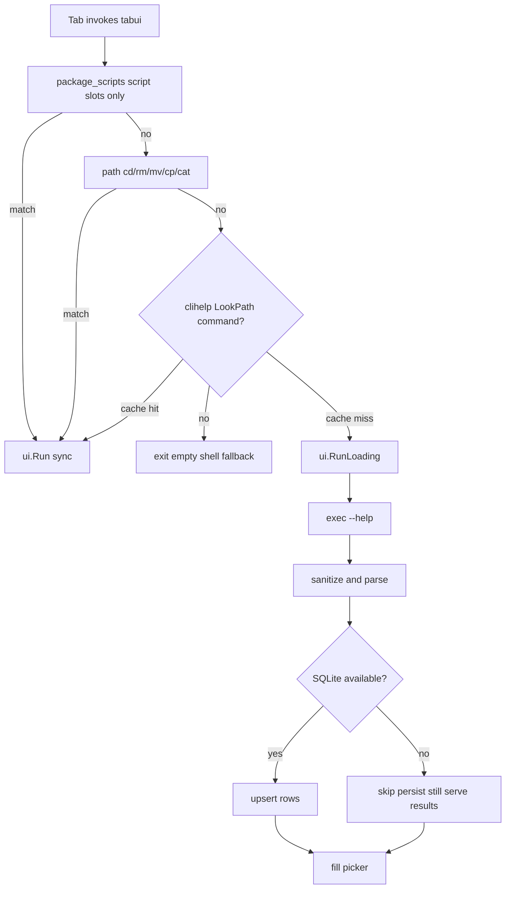

# tabui

A Go CLI + TUI that suggests the **next thing to type** while you compose a shell command — paths, scripts, subcommands, or flags, depending on context.

Press **Tab** in your shell: tabui opens a fuzzy picker with **label** + **detail**, you pick a row, and that token is inserted into the line. Works in any terminal. If nothing matches, the shell falls back to normal completion.

| You are typing | tabui suggests |
|----------------|----------------|
| `pnpm run ` / `npm run ` | scripts from nearest `package.json` |
| `mv ` / `cp ` / `rm ` / `cd ` | files and folders (paths); curated flags when the token starts with `-` |
| `docker ` / `git ` / `npm ` / `brew ` / … | subcommands and flags from `cmd [sub…] --help` (cached) |

## Provider order

Specialized providers run first; CLI help is the fallback for anything else on your `PATH`.



## Status

Target: suggest the next token from context (package scripts, paths, flags, …) via a Tab fuzzy picker in any terminal.

**Status:** ✅ ready · 🚧 in progress · ❌ not started

| Piece | Notes | Status |
|-------|-------|--------|
| Package scripts provider | `npm` / `pnpm` / `yarn` / `bun` **run** slots; nearest `package.json` in Go | ✅ |
| Generic TUI | Fuzzy list with label + detail; `RunLoading` for async help | ✅ |
| CLI wiring | `--line` / `--cwd` / `--cursor` | ✅ |
| zsh + bash Tab keybinding | `tabui init`; falls back when no match | ✅ |
| Path provider | Files/folders for `mv` / `cp` / `cd` / `rm` / `cat`; curated flags when the token starts with `-` | ✅ |
| CLI help fallback | Any other LookPath command (`docker`, `git`, `brew`, npm-family tool-level, …): `--help` on demand, sanitize/parse subcommands + flags, SQLite cache when available; picker shows `loading…` on cache miss | ✅ |
| More specialized providers | Extra Match → Suggest packs where help-scrape is a poor fit | ❌ |

## Install

Requires Go 1.26+.

1. Install the binary onto your `PATH`:

```bash
go install github.com/MaxiGarcia13/tabui/cmd/tabui@latest
```

Or from a clone:

```bash
go install ./cmd/tabui
```

2. Enable the Tab widget — add one line to your shell rc:

**zsh** — `~/.zshrc`:

```zsh
eval "$(tabui init zsh)"
```

**bash** — `~/.bashrc`:

```bash
eval "$(tabui init bash)"
```

3. Open a new shell (or re-source your rc file).

Try: `pnpm run ` + **Tab** → scripts; `mv ` + **Tab** → paths; `docker ` + **Tab** → subcommands from help; `cd -` + **Tab** → flags.

### Disable

| Scope | zsh | bash |
|-------|-----|------|
| This session | `bindkey '^I' expand-or-complete` | `bind '"\t": complete'` |
| Permanent | Remove the `eval "$(tabui init …)"` line from your rc file | same |

## Update

Re-run the install command. `go install` replaces the binary already on your `PATH`:

```bash
go install github.com/MaxiGarcia13/tabui/cmd/tabui@latest
```

From a clone:

```bash
git pull
go install ./cmd/tabui
```

Check the installed version with `tabui -version`. Then open a new shell (or re-source your rc file) so `eval "$(tabui init …)"` loads the widget from the new binary.

## Contributing

See [CONTRIBUTING.md](CONTRIBUTING.md) for development setup, tests, and layout.
